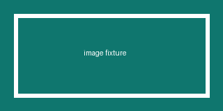

# 全元素验收

## 表格

| 项目 | 说明 | 金额 |
| :--- | :---: | ---: |
| 单行 | 居中文本 | 100 |
| 另一行 | 内容 | 2000 |

## 任务列表

- [x] 计划
- [ ] 开发
  - [x] 子任务
- [ ] 发布

## 代码块

```rust
fn main() {
    println!("hello");
}
```

## 图片

本地照片（有固有尺寸）：



SVG 图标（尺寸未知，占位盒）：


缺失图片（占位 + alt）：


远程图片（首帧前预加载）：


## 脚注与内联元素

正文脚注[^1]，删除线 ~~已废弃~~，以及嵌套引用：

> 外层引用
>
> > 内层引用

[^1]: 这是脚注内容。
